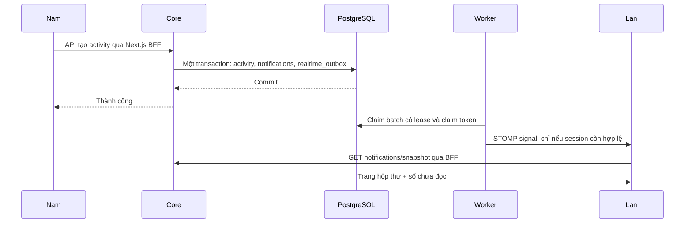

**Thông báo đã triển khai: cấu trúc, cách chạy và cách đọc code**

Bản đầu chạy với **một Core instance**, có PostgreSQL, REST API, WebSocket/STOMP, outbox và giao diện chuông/hộp thư. Chưa triển khai Redis bridge, chat hoặc push nền. Database ứng dụng chưa được migrate; không chạy migration lên DB ứng dụng trong phiên phát triển theo AGENTS.md.

**1. Những gì người dùng nhận được**

- OWNER thêm trực tiếp: người được thêm nhận thông báo đã vào trip.
- VICE mời: người được mời nhận thông báo lời mời; OWNER nhận yêu cầu duyệt.
- Duyệt thành viên: người được duyệt nhận thông báo.
- Thêm hoạt động lịch trình: thành viên ACTIVE chưa bị xóa, trừ người thao tác, nhận thông báo.
- AI thêm lịch trình: một thông báo tổng hợp cho mỗi người nhận.
- Chuông có số chưa đọc; mở hộp thư, đánh dấu từng thông báo/tất cả, phân trang và mở trip liên quan.
- Mobile dùng AppDialog toàn màn hình và nút Thoát trên cùng; desktop dùng dialog.
- Mất socket vẫn đọc qua API; reconnect, focus, trở lại online hoặc mở hộp thư đều đồng bộ.

Nghiệp vụ thành viên giữ nguyên: OWNER thêm thành ACTIVE, VICE mời thành INVITED, OWNER/VICE duyệt. Không thêm nút tự chấp nhận cho người được mời. Lời mời chưa duyệt chỉ có thông tin tối thiểu và không mở lịch trình. Đích đã bị xóa/đã xử lý trả UNAVAILABLE.

**2. Luồng thực tế**



NotificationService dùng Propagation.MANDATORY cho ghi nghiệp vụ: chỉ được gọi trong transaction của service nghiệp vụ. Nếu tạo hoạt động rollback thì notification/outbox cũng rollback. Worker gửi ngoài transaction DB; việc claim và ghi nhận kết quả dùng transaction ngắn riêng qua OutboxStore.

Sự kiện chỉ có schemaVersion, eventId và type; không gửi tên trip, nội dung hoạt động hoặc userId do client chọn qua socket. Frontend refetch API được kiểm tra quyền. GET snapshot dùng transaction REPEATABLE_READ để trang danh sách và badge cùng nhìn một snapshot DB. Các event gần nhau được gộp; event đến trong khi GET đang chạy tạo thêm lượt đồng bộ sau GET đó.

**3. Các file chính và vai trò**

| File/module | Vai trò |
|---|---|
| notification/entities/NotificationEntity | Một bản ghi cho mỗi người nhận; read_at độc lập |
| notification/entities/RealtimeOutboxEntity | Công việc cần phát, attempts, lease, claim_token, dispatched_at |
| notification/repositories/NotificationRepository | Predicate quyền chung cho list/count/read/target; chặn thông báo trip đã xóa hoặc membership bị thu hồi |
| notification/services/NotificationService | Chọn recipients, tạo notification/outbox, đọc hộp thư và kiểm tra đích đến |
| notification/services/OutboxStore | Claim độc quyền bằng UPDATE có điều kiện; chỉ claim token hiện tại được hoàn tất |
| notification/services/NotificationOutboxWorker | Batch 50, retry tối đa 10 lần, backoff, ghi log FAILED; dọn tối đa 500 outbox dispatched trên 7 ngày mỗi phút |
| realtime/RealtimeConfig | Endpoint /ws, broker /queue, heartbeat và giới hạn frame/buffer/thời gian gửi |
| realtime/RealtimeSchedulingConfig | Scheduler độc lập, không phụ thuộc service/repository; tránh vòng lặp với JPA bootstrap |
| security/SecurityConfig | Chain riêng cho handshake/bootstrap, JWT cookie/Bearer, Redis session và policy |
| realtime/RealtimeCsrfHandshakeInterceptor | Chụp token raw từ cùng cookie repository vào session socket; CONNECT gửi token masked để Spring kiểm tra |
| realtime/RealtimeMessageSecurity | Chỉ cho subscribe queue cá nhân; từ chối SEND và subscription khác |
| realtime/RealtimeSessions | Theo dõi socket, kiểm tra JWT expiry/session/policy trước phát và mỗi 15 giây; phát theo từng session |
| realtime/RealtimeBootstrapController | Trả token CSRF masked và cookie cần cho CONNECT, không cache |
| ../trip-budget-web/src/base/realtime/connect-realtime.ts | STOMP client, WSS, heartbeat, reconnect, bootstrap và dedupe eventId |
| Frontend features/notification | Feature hook/coordinator, provider theo tài khoản, chuông và hộp thư |
| Frontend app/api/notifications | BFF với allowlist route, token HttpOnly và no-store |
| Frontend app/api/realtime/bootstrap | Forward cookie CSRF hiện có, relay riêng từng Set-Cookie; thêm Secure ở production |

Đường dẫn frontend ở bảng được tính theo workspace; frontend là repo cạnh thư mục trip-budget. Các link hướng dẫn trước đây là mã giải thích; source hiện tại và tài liệu này là hợp đồng bản đã triển khai.

**4. API đã có**

Các URL bên dưới nhìn từ browser. Core có cùng suffix phía sau context /api.

| Method và URL | Chức năng |
|---|---|
| GET /api/notifications?page=0&size=20&unreadOnly=false | PageResponse của thông báo nhìn thấy được |
| GET /api/notifications/snapshot | { listing: PageResponse, unreadCount } trong một snapshot |
| GET /api/notifications/unread-count | Số chưa đọc hiện tại |
| PATCH /api/notifications/{id}/read | Đánh dấu đọc của chính người gọi, idempotent |
| PATCH /api/notifications/read-all | Một UPDATE cho các dòng nhìn thấy ở snapshot của câu lệnh |
| GET /api/notifications/{id}/target | Kiểm tra lại quyền và trả { available, path, status } |
| GET /api/realtime/bootstrap | Cookie/token CSRF để mở STOMP |

Core lấy @CurrentUser, không nhận recipientId từ client. ID nghiệp vụ trả client dùng Hashids, event ID dùng UUID. List/count áp dụng cùng predicate quyền; sau khi bị xóa khỏi trip, user không tiếp tục đọc chi tiết qua API notification. Dữ liệu cũ đã hiển thị có thể còn trên màn hình cho tới lượt đồng bộ tiếp theo.

**5. Setup local**

Từ workspace có hai repo trip-budget và trip-budget-web.

1. Kiểm tra và áp dụng migration `trip-budget/tripbudget-core/src/main/resources/db/migration/V5__notifications_realtime.sql` theo quy trình DB của bạn **trước khi chạy Core mới**. Migration tạo notifications và realtime_outbox; không đụng dữ liệu cũ. ddl-auto=validate không tự chạy migration. File versioned này chạy một lần, không chạy lặp như script reset.

Ví dụ trong thư mục trip-budget/tripbudget-core, PG_CONNECTION_URL phải là kết nối PostgreSQL dành cho psql (không dùng tiền tố jdbc):

```bash
psql "$PG_CONNECTION_URL" -v ON_ERROR_STOP=1 -f src/main/resources/db/migration/V5__notifications_realtime.sql
```

Lệnh trên là hướng dẫn vận hành; agent chưa chạy lên database ứng dụng.

2. Giữ các cấu hình DB/JWT/Redis đang dùng; bổ sung vào môi trường Core:

```dotenv
APP_WEB_ORIGIN=http://localhost:8080
NOTIFICATION_DISPATCH_DELAY_MS=1000
```

APP_WEB_ORIGIN là origin browser, gồm scheme, host và port; không thêm đường dẫn /realtime.

3. Frontend giữ các cấu hình identity hiện có. Cấu hình môi trường server mới:

```dotenv
CORE_API_BASE_URL=http://localhost:8081/api
NEXT_PUBLIC_APP_BASE_URL=http://localhost:8080
```

NEXT_PUBLIC_APP_BASE_URL cũng có thể để trống để dùng same-origin; không trỏ trực tiếp tới cổng 3000 khi thực hành qua proxy. Thay đổi biến NEXT_PUBLIC cần restart dev/build. Không đưa secret vào biến NEXT_PUBLIC. Package và lockfile đã thêm @stomp/stompjs; checkout trên máy khác chạy npm ci.

4. Chạy Core và Next.js theo các terminal riêng:

```bash
# Trong trip-budget/tripbudget-core, sau khi chuẩn bị migration và env
mvn spring-boot:run
```

```bash
# Trong trip-budget-web
npm run dev -- --hostname 0.0.0.0
```

5. Trong trip-budget, bật proxy local đã thêm vào docker-compose.yml:

```bash
docker compose --profile realtime up -d realtime-proxy
```

Proxy Nginx dùng dev/nginx-realtime.conf, mở localhost:8080. /realtime chuyển WebSocket Upgrade tới Core /api/ws; HTTP còn lại đi Next.js, bao gồm BFF bootstrap. Upstream host.docker.internal trỏ host qua host-gateway, phù hợp container proxy và hai dịch vụ chạy trên host. Core mặc định port 8081/context /api, frontend port 3000; đổi upstream nếu env thực tế khác.

6. Truy cập và đăng nhập bằng http://localhost:8080. Dùng browser profile riêng cho hai tài khoản vì các tab cùng profile chia sẻ cookie. Nếu Google OAuth chưa cho phép origin mới, cập nhật cấu hình OAuth theo quy trình hiện có hoặc dùng đăng nhập email để kiểm chứng local.

DevTools Network: bootstrap 200 → WebSocket 101 → STOMP CONNECTED → SUBSCRIBE. Khi thêm hoạt động từ tài khoản khác: MESSAGE signal → GET snapshot → badge/danh sách cập nhật.

Production cần HTTPS/WSS, Origin chính xác, proxy Upgrade/idle timeout, TLS/forwarded headers được cấu hình từ proxy tin cậy và cookie Secure. File Nginx bổ sung là cho local, không phải cấu hình TLS production.

**6. Xử lý lỗi và đánh đổi**

- Worker đánh dấu DISPATCHED là đã xử lý qua transport cục bộ, không phải client đã nhận hoặc đã đọc. Offline không giữ job chờ mãi; API trả lịch sử sau này.
- Crash sau gửi nhưng trước ack có thể phát lặp. Client dedupe tối đa 500 event ID và refetch dữ liệu có thẩm quyền, không tăng badge mù.
- Bootstrap lỗi tạm thời được thử lại; session/policy 401/403 sau xử lý auth hiện có thì dừng vòng reconnect. Reconnect và focus đều resync.
- Token expiry/session revocation không tự áp dụng cho socket chỉ vì HTTP đã xác thực. RealtimeSessions kiểm tra trước outbound/inbound và định kỳ; lỗi xác minh đóng socket. Đây là các lần kiểm tra có độ trễ thực thi, không phải giao dịch nguyên tử với Identity logout.
- Simple broker và session registry chỉ cục bộ. **Không tăng Core replica khi chưa có Redis bridge hoặc broker relay.** Shared database/outbox không tự chuyển message sang node đang giữ socket.
- Worker polling DB một lần theo nhịp, khác từng browser polling HTTP. Đây là đổi thêm bảng/worker lấy khả năng phục hồi crash và tránh request lặp theo từng người dùng.
- Trạng thái đọc và badge giữa các thiết bị có tính đồng bộ cuối cùng qua signal/API. Chưa cam kết replay WebSocket hoặc exactly-once delivery.
- Không có FCM/push nền khi app đóng. Không có chat trong bản này; kết nối/auth/dispatch có thể dùng lại khi thêm message persistence, thứ tự và read cursor riêng.

FAILED outbox được giữ lại và ghi log với ID. Sau khi sửa nguyên nhân, operator có thể retry các ID đã kiểm tra bằng cập nhật status=PENDING, attempts=0, next_attempt_at=NOW(), lease_until=NULL, claim_token=NULL; không tự retry vô hạn và không xóa notification. Không có API công khai quản trị outbox.

**7. Kiểm chứng**

Script sau khởi tạo PostgreSQL cục bộ dùng một lần, user notification_test, DB template_test, rồi chạy Maven clean test. Script tắt PostgreSQL khi xong và giữ log dưới /tmp. Không dùng URL DB từ .env ứng dụng. Cần PostgreSQL binaries/pg_config và dependency Maven đã có trong cache:

```bash
# Trong tripbudget-core
bash scripts/test-notifications.sh
```

Guard của integration test chỉ nhận jdbc:postgresql://localhost hoặc 127.0.0.1 với port rõ ràng và database template_test. Nếu port 55479 đã dùng, chạy với NOTIFICATION_TEST_PORT khác. Chạy mvn -o clean test trực tiếp sẽ bỏ qua các integration test khi thiếu env opt-in; không nhầm lượt skip đó là đã kiểm thử PostgreSQL/WebSocket.

Frontend:

```bash
npx tsc --noEmit
npx eslint src/features/notification src/base/realtime src/app/api/notifications src/app/api/realtime src/base/components/layout/AppShell.tsx src/base/components/layout/AppTopBar.tsx
node --test --test-isolation=none tests/notifications.test.mjs tests/auth-refresh.test.mjs
```

Đã kiểm chứng trong phiên: migration/JPA mapping và truy vấn thật, rollback, recipient/actor, member bị thu hồi, đọc chéo user bị chặn, read idempotent, lời mời chờ duyệt, target không khả dụng, outbox claim độc quyền/lease/stale acknowledgement/retry; HTTP cookie + masked CSRF + WebSocket/STOMP thật, cách ly user và chặn SEND/subscription trái phép, session bị thu hồi; client reconnect/dedupe/logout race, BFF allowlist và chuyển tiếp cookie; TypeScript/ESLint. Bỏ qua smoke test theo AGENTS.md.

Chưa chạy browser kiểm chứng hình ảnh, chưa đo tải P95/throughput, chưa kiểm chứng end-to-end bằng tài khoản và DB ứng dụng. Không có kết quả đo năng lực phục vụ nhiều người dùng từ các test chức năng này.

**8. Sửa vòng lặp JPA và realtime khi khởi động (30/10/2026)**

Scheduler ban đầu được khai báo bằng method @Bean trên RealtimeConfig và trả về ThreadPoolTaskScheduler. Kiểu này cũng triển khai AsyncTaskExecutor; Spring Boot 4.1 thu thập các executor khi tạo entityManagerFactoryBuilder. Khởi tạo scheduler kéo theo RealtimeConfig → RealtimeSessions → UserRepository → EntityManagerFactory đang được tạo, gây vòng lặp.

Đã chuyển scheduler và @EnableScheduling sang RealtimeSchedulingConfig không có dependency, công khai bean bằng interface TaskScheduler. RealtimeConfig chỉ cấu hình WebSocket, không còn sở hữu bean scheduler tác vụ. Không bật allow-circular-references.

JpaRealtimeContextIntegrationTest bổ sung khởi tạo entrypoint Core thật, JPA auto-configuration và repository thật cùng realtime, với circular references bị tắt. PostgreSQL là DB dùng một lần; Redis được mock để không dùng hạ tầng ứng dụng. Các context JPA kiểm thử được đóng sau mỗi class để tránh va chạm schema trong cùng DB tạm. Lượt clean test sau sửa: 22 test qua, không skip. Các test cũ tách JPA/WebSocket nên chưa phát hiện được lỗi khởi tạo chung này.
