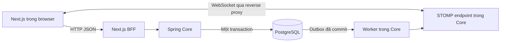

**Học và setup thông báo TripBudget: từ giao thức đến code**

Tài liệu ngày 30/10/2026, đi cùng [kế hoạch triển khai](notifications-websocket-plan.vi.md). Bản đầu đã có trong source; xem [cách chạy và hợp đồng thực tế](notifications-implementation.vi.md). Các đoạn dưới đây là bài giải thích rút gọn, không thay thế toàn bộ cấu hình thực tế, đặc biệt handshake interceptor, quản lý session và outbox. Những đoạn được ghi mã giả vẫn chỉ minh họa trách nhiệm.

**1. Bắt đầu từ vấn đề, không bắt đầu từ thư viện**

Nam tạo một hoạt động trong trip. Server biết ngay vì vừa xử lý request của Nam. Trình duyệt của Lan là một tiến trình khác, không tự biết database vừa đổi.

Với HTTP request/response thông thường, Lan phải gửi request để nhận dữ liệu. Polling là gửi những request đó định kỳ. WebSocket mở một kết nối hai chiều tồn tại trong một khoảng thời gian; server có thể gửi thông điệp khi có thay đổi mà không chờ một GET mới từ Lan. HTTP vẫn có thể tái sử dụng kết nối TCP; khác biệt nằm ở cách trao đổi thông điệp, không phải cứ HTTP là mở/đóng TCP cho từng request. [MDN WebSocket](https://developer.mozilla.org/en-US/docs/Web/API/WebSockets_API).

So sánh để hình dung: API giống một lần hỏi và nhận câu trả lời; WebSocket giống một cuộc gọi đang nối, hai phía có thể lên tiếng. Khi cuộc gọi ngắt, câu nói cũ không tự nằm trong một hộp thư. PostgreSQL chính là nơi lưu thông báo để đọc lại.

WebSocket không tự cung cấp database, quyền thành viên, lịch sử, xác nhận đã đọc, retry nghiệp vụ hay push của hệ điều hành. Những phần đó do ứng dụng xây dựng.

**2. Những từ sẽ gặp và nghĩa của chúng**

| Từ | Nghĩa | Trong TripBudget |
|---|---|---|
| Client | Bên mở kết nối | Trình duyệt của Lan |
| Server | Bên nhận kết nối, xử lý nghiệp vụ | Spring Boot Core |
| Handshake | Thỏa thuận ban đầu để thiết lập WebSocket | Request tới /realtime |
| ws / wss | WebSocket / WebSocket được mã hóa TLS | Local ws, production wss |
| Frame | Đơn vị truyền của WebSocket | Mang các byte của thông điệp |
| STOMP | Giao thức ứng dụng mô tả CONNECT, SUBSCRIBE, SEND, MESSAGE | Thống nhất cách nhận/gửi trong Spring và browser |
| Destination | Tên tuyến logic của thông điệp | /user/queue/notifications |
| Subscription | Đăng ký nhận tại một destination | Lan đăng ký queue của mình |
| Broker | Thành phần định tuyến tới subscription phù hợp | Spring simple broker trong một instance |
| Principal | Danh tính đã được backend xác thực | JWT sub của Lan |
| Heartbeat | Tín hiệu kiểm tra kết nối có còn hoạt động | Phát hiện mạng bị mất |
| Reconnect | Tạo kết nối mới sau khi kết nối cũ ngắt | Đổi Wi-Fi sang 4G |
| Resync | Tải lại trạng thái từ nguồn dữ liệu chính | GET thông báo sau reconnect |
| Transaction | Một nhóm thay đổi DB thành công hoặc rollback cùng nhau | Activity + notification + outbox |
| Outbox | Bảng ghi việc cần phát ra ngoài transaction | “Cần báo notification X cho Lan” |
| Idempotency | Thực hiện lại mà không tạo thêm tác dụng nghiệp vụ | Gọi đánh dấu đọc hai lần vẫn chỉ đã đọc |

STOMP frame và WebSocket frame là hai lớp khác nhau; thư viện xử lý đóng gói/phân mảnh, không cần giả định một STOMP message luôn tương ứng đúng một WebSocket frame. Chữ queue trong destination không tự tạo hàng đợi bền vững; simple broker không lưu tin cho người offline.

**3. Một kết nối bắt đầu ra sao?**

```text
Browser                         Spring Core
   |---- HTTP handshake ----------->|
   |<--- HTTP 101 Upgrade ----------|  Với cách kết nối HTTP/1.1 trong bài
   |---- STOMP CONNECT ------------>|
   |<--- STOMP CONNECTED -----------|
   |---- STOMP SUBSCRIBE ---------->|
   |      /user/queue/notifications |
   |                               |
   |<--- STOMP MESSAGE ------------|  Khi có sự kiện cho user này
```

101 chỉ nói đã thiết lập WebSocket ở lớp HTTP, chưa chứng minh STOMP CONNECT hợp lệ hoặc đã subscribe. Một kết nối có thể chứa nhiều subscription: notification, chat, trạng thái đồng bộ. Một tab thường chỉ cần một kết nối chung.

Spring hỗ trợ STOMP trên WebSocket; không cần dùng Socket.IO client vì đó là một giao thức khác và không tương thích trực tiếp với endpoint STOMP này. SockJS là giải pháp fallback transport khác; bản đầu dùng native WebSocket, không thêm SockJS khi chưa có nhu cầu. [Spring STOMP](https://docs.spring.io/spring-framework/reference/web/websocket/stomp/enable.html).

**4. Kiến trúc và các đường dữ liệu**



API tạo hoạt động, lấy danh sách và đánh dấu đọc vẫn đi BFF. WebSocket dùng đường kết nối riêng qua proxy; nó không tự đi qua các Next.js route JSON hiện tại.

Trong phần setup dưới đây, bootstrap CSRF cũng có một route proxy riêng để browser nhận trực tiếp cookie CSRF từ Core cùng origin. Đây là cách cụ thể hóa đường bootstrap của kế hoạch, giúp tránh viết BFF chuyển tiếp Set-Cookie trong bài học. Có thể dùng BFF thay thế nhưng phải chuyển tiếp đúng cả cookie CSRF vào và Set-Cookie ra.

**5. Bước setup 1: thêm dependency**

Trong pom.xml của tripbudget-core, thêm các dependency sau; để Spring Boot parent hiện có quản lý version:

```xml
<dependency>
    <groupId>org.springframework.boot</groupId>
    <artifactId>spring-boot-starter-websocket</artifactId>
</dependency>
<dependency>
    <groupId>org.springframework.security</groupId>
    <artifactId>spring-security-messaging</artifactId>
</dependency>
```

Starter thứ nhất cung cấp hỗ trợ WebSocket/STOMP cho Spring MVC. Dependency thứ hai cung cấp bảo vệ ở lớp message; bảo vệ HTTP handshake chưa đủ để quyết định client được subscribe/gửi vào đâu. [Spring Boot WebSocket](https://docs.spring.io/spring-boot/reference/messaging/websockets.html).

Trong thư mục trip-budget-web, chạy khi bắt đầu triển khai:

```bash
npm install @stomp/stompjs
```

Thư viện frontend quản lý STOMP CONNECT, subscribe, heartbeat và vòng đời kết nối. Lưu lockfile và kiểm tra phiên bản đã cài. Không cần dựng WebSocket server trong Next.js vì server của tính năng này là Core.

**6. Bước setup 2: endpoint và broker**

Tạo realtime/RealtimeConfig.java trong package com.tripbudget.tripbudget_core. Imports tiêu chuẩn có thể để IDE bổ sung; code bên dưới thể hiện toàn bộ nội dung cấu hình chính.

```java
@Configuration
@EnableWebSocketMessageBroker
public class RealtimeConfig implements WebSocketMessageBrokerConfigurer {
    private final String appOrigin;
    private TaskScheduler heartbeatScheduler;

    public RealtimeConfig(@Value("${app.web-origin}") String appOrigin) {
        this.appOrigin = appOrigin;
    }

    @Autowired
    public void setHeartbeatScheduler(
            @Lazy @Qualifier("messageBrokerTaskScheduler") TaskScheduler scheduler) {
        this.heartbeatScheduler = scheduler;
    }

    @Override
    public void registerStompEndpoints(StompEndpointRegistry endpoints) {
        endpoints.addEndpoint("/ws").setAllowedOrigins(appOrigin);
    }

    @Override
    public void configureMessageBroker(MessageBrokerRegistry broker) {
        broker.setApplicationDestinationPrefixes("/app");
        broker.setUserDestinationPrefix("/user");
        broker.enableSimpleBroker("/queue")
                .setHeartbeatValue(new long[] {10_000, 10_000})
                .setTaskScheduler(heartbeatScheduler);
    }
}
```

| Dòng cấu hình | Tác dụng |
|---|---|
| @EnableWebSocketMessageBroker | Bật hạ tầng xử lý STOMP trên WebSocket |
| addEndpoint('/ws') | Địa chỉ handshake, không phải một queue |
| setAllowedOrigins | Cho phép đúng origin của app, gồm scheme/host/port |
| /app | Prefix cho lệnh gửi tới @MessageMapping sau này, ví dụ chat |
| /user | Prefix để Spring ánh xạ tới user/session đã xác thực |
| enableSimpleBroker('/queue') | Định tuyến tới subscription trong bộ nhớ của instance này |
| heartbeat + TaskScheduler | Cho broker gửi/kiểm tra nhịp sống; client cũng phải cấu hình |
| @Lazy | Tránh vòng phụ thuộc với scheduler do hạ tầng WebSocket tạo |

app.web-origin lấy từ cấu hình môi trường. Ví dụ local qua proxy http://localhost:8080; production là origin HTTPS thật. Không dùng '*' cho kết nối chứa dữ liệu tài khoản.

Core hiện có context path /api, nên endpoint thực tại Core là /api/ws. Các destination STOMP /app, /user, /queue không có thêm context path này vì chúng không phải URL HTTP.

**7. Bước setup 3: hiểu và nối xác thực**

Frontend đang dùng access_token HttpOnly: browser có thể gửi cookie, JavaScript không đọc được giá trị. WebSocket browser không cho tự đặt HTTP Authorization header như Axios. Vì vậy thêm một security chain riêng cho /ws và /realtime/bootstrap, đọc cookie tại hai endpoint đó; các API còn lại giữ chain Bearer hiện có.

```text
Cookie access_token
  → JwtDecoder xác minh chữ ký và hạn
  → RedisSessionValidationFilter kiểm tra type/sid/session
  → PolicyAcceptanceFilter
  → Principal của HTTP handshake
  → Principal của WebSocket/STOMP
```

Không chỉ Base64 decode JWT và tin userId trong payload. Không nhận userId từ browser để quyết định Principal. Với converter mặc định đang dùng, Principal.getName() là JWT sub, tức ID user nội bộ dạng chuỗi. [Spring authentication](https://docs.spring.io/spring-framework/reference/web/websocket/stomp/authentication.html).

Ví dụ method bean thêm vào SecurityConfig hiện có (tận dụng các field filter/error-handler hiện có):

```java
@Bean
@Order(1)
SecurityFilterChain realtimeHttpSecurity(HttpSecurity http) throws Exception {
    var cookieCsrf = new CookieCsrfTokenRepository();
    cookieCsrf.setCookieName("WS-XSRF-TOKEN");
    cookieCsrf.setCookiePath("/");
    cookieCsrf.setCookieCustomizer(cookie -> cookie
            .httpOnly(true)
            .sameSite("Lax"));
    // Secure mặc định dựa trên request HTTPS; proxy/TLS phải cấu hình đúng.

    var bearerResolver = new DefaultBearerTokenResolver();
    BearerTokenResolver resolver = request -> {
        String bearer = bearerResolver.resolve(request);
        if (bearer != null) return bearer;
        var cookie = WebUtils.getCookie(request, "access_token");
        return cookie == null ? null : cookie.getValue();
    };

    return http
            .securityMatcher("/ws", "/realtime/bootstrap")
            .sessionManagement(session -> session
                    .sessionCreationPolicy(SessionCreationPolicy.STATELESS))
            .csrf(csrf -> csrf.csrfTokenRepository(cookieCsrf))
            .authorizeHttpRequests(auth -> auth.anyRequest().authenticated())
            .oauth2ResourceServer(oauth -> oauth
                    .bearerTokenResolver(resolver)
                    .jwt(Customizer.withDefaults())
                    .authenticationEntryPoint(customAuthenticationEntryPoint)
                    .accessDeniedHandler(customAccessDeniedHandler))
            .exceptionHandling(errors -> errors
                    .authenticationEntryPoint(customAuthenticationEntryPoint)
                    .accessDeniedHandler(customAccessDeniedHandler))
            .addFilterAfter(redisSessionValidationFilter,
                    BearerTokenAuthenticationFilter.class)
            .addFilterAfter(policyAcceptanceFilter,
                    RedisSessionValidationFilter.class)
            .build();
}
```

@Order(1) cho chain hẹp này chạy trước chain mặc định. Cookie fallback chỉ có hiệu lực trong chain đó, không mở cookie auth cho mọi REST endpoint. Trong ứng dụng hiện tại, khi thêm chain phải bảo đảm các filter tùy chỉnh chỉ được đăng ký trong SecurityFilterChain, không chạy lặp như servlet filter toàn cục. PolicyAcceptanceFilter đã có FilterRegistrationBean tắt đăng ký tự động; áp dụng tương tự cho RedisSessionValidationFilter nếu chưa có.

CSRF là gì: một trang ngoài có thể cố dùng cookie browser của bạn để mở kết nối/gửi lệnh. Token CSRF và kiểm tra Origin bảo vệ việc mở phiên STOMP. Token CSRF không phải access token và không thay thế xác thực.

Thêm controller bootstrap; @RequestMapping không lặp /api vì servlet context đã có /api:

```java
@RestController
@RequestMapping("/realtime")
public class RealtimeBootstrapController {
    public record Bootstrap(String headerName, String token) {}

    @GetMapping("/bootstrap")
    public ResponseEntity<ApiResponse<Bootstrap>> bootstrap(
            @CurrentUser CurrentUserDto user, CsrfToken csrf) {
        Long currentUserId = user.id();
        // Identity đã qua security filters; không lấy userId từ request.
        var body = new Bootstrap(csrf.getHeaderName(), csrf.getToken());
        return ResponseEntity.ok()
                .cacheControl(CacheControl.noStore())
                .body(ApiResponse.success(HttpStatus.OK, "Realtime ready", body));
    }
}
```

Giữ request handler CSRF mặc định của Spring Security cho ví dụ này: token JSON là token đã được mask, STOMP CONNECT gửi lại chính giá trị đó. Không tự đọc cookie WS-XSRF-TOKEN hoặc thay bằng một chuỗi ngẫu nhiên. @EnableWebSocketSecurity dùng cơ chế CSRF cho CONNECT; HTTP csrf.disable ở chain cũ không tắt cơ chế này. [Spring WebSocket Security](https://docs.spring.io/spring-security/reference/servlet/integrations/websocket.html), [CSRF](https://docs.spring.io/spring-security/reference/servlet/exploits/csrf.html).

**8. Bước setup 4: quyền subscribe/gửi message**

```java
@Configuration
@EnableWebSocketSecurity
public class RealtimeMessageSecurity {
    @Bean
    AuthorizationManager<Message<?>> realtimeAuthorization(
            MessageMatcherDelegatingAuthorizationManager.Builder messages) {
        return messages
                .nullDestMatcher().authenticated()
                .simpSubscribeDestMatchers("/user/queue/notifications")
                    .authenticated()
                .anyMessage().denyAll()
                .build();
    }
}
```

Đây là quyền cho bản thông báo chỉ nhận: cho control frame của user đã đăng nhập và SUBSCRIBE chính xác vào queue cá nhân; các SEND và subscription khác bị từ chối. Client không được gửi thông báo giả trực tiếp vào /queue. Khai báo prefix /app ở cấu hình trước không đồng nghĩa client đã được phép gửi vào đó. Khi làm chat, thêm đúng quyền SEND và kiểm tra membership trong handler.

Không dùng hasRole('USER') chỉ vì ví dụ trên mạng có: JWT converter hiện tại chưa chắc tạo authority ROLE_USER. Cần phân biệt “đã đăng nhập” và “có quyền trong trip”.

**9. Bước setup 5: reverse proxy**

Ví dụ Nginx local chạy cùng máy: frontend 3000, Core 8081, browser mở localhost:8080. Nếu Nginx chạy trong container, localhost trong container không trỏ tới host; sửa upstream theo môi trường.

```nginx
# Bên trong http {}
map $http_upgrade $connection_upgrade {
    default upgrade;
    ''      close;
}

server {
    listen 8080;
    server_name localhost;

    location = /realtime {
        proxy_pass http://127.0.0.1:8081/api/ws;
        proxy_http_version 1.1;
        proxy_set_header Upgrade $http_upgrade;
        proxy_set_header Connection $connection_upgrade;
        proxy_set_header Host $http_host;
        proxy_set_header X-Forwarded-Proto $scheme;
        proxy_read_timeout 75s;
    }

    location = /api/realtime/bootstrap {
        proxy_pass http://127.0.0.1:8081/api/realtime/bootstrap;
        proxy_set_header Host $http_host;
        proxy_set_header X-Forwarded-Proto $scheme;
        proxy_cache off;
    }

    location / {
        proxy_pass http://127.0.0.1:3000;
        proxy_http_version 1.1;
        proxy_set_header Upgrade $http_upgrade;
        proxy_set_header Connection $connection_upgrade;
        proxy_set_header Host $http_host;
        proxy_set_header X-Forwarded-Proto $scheme;
    }
}
```

Hai route chính xác ở trên tới Core, các route khác tới Next.js/BFF. Cookie, Origin và Set-Cookie được proxy chuyển tiếp theo mặc định; không cấu hình xóa chúng. Cookie CSRF path '/' cho phép nó đi tới public /realtime dù Core có context /api.

Đăng nhập và học qua cùng địa chỉ localhost:8080; app.web-origin phải là http://localhost:8080. NEXT_PUBLIC_APP_BASE_URL của frontend cần để trống (same-origin) hoặc đặt đúng http://localhost:8080, không còn trỏ thẳng tới cổng 3000. Cấu hình external origin của auth/Next theo môi trường local hiện có. Production thêm TLS, dùng wss và cấu hình forwarded headers từ proxy tin cậy để Core nhận biết HTTPS và cookie Secure. Không mở Core nhận forwarded headers không kiểm soát từ Internet. [Nginx WebSocket proxying](https://nginx.org/en/docs/http/websocket.html).

**10. Bước setup 6: client TypeScript**

Ví dụ transport helper đặt src/base/realtime/connect-notifications.ts. Được gọi từ useEffect của provider client, không gọi trong SSR hoặc mỗi lần render. Cần bổ sung runtime validation payload đầy đủ khi hoàn thiện feature; ví dụ đầu tiên chỉ báo rằng có dữ liệu đổi để tránh tin nội dung ngoài hợp đồng.

```ts
import { Client } from '@stomp/stompjs';
import { axiosClient } from '@/base/api/axios-client';

type Bootstrap = {
  status: number;
  data: { headerName: string; token: string };
};

export function connectNotifications(
  onChanged: () => void,
  onError: (message: string) => void,
) {
  const endpoint = new URL('/realtime', window.location.origin);
  endpoint.protocol = window.location.protocol === 'https:' ? 'wss:' : 'ws:';
  let disposed = false;

  const client = new Client({
    brokerURL: endpoint.toString(),
    reconnectDelay: 5000,
    heartbeatIncoming: 10000,
    heartbeatOutgoing: 10000,
    connectionTimeout: 10000,
  });

  client.beforeConnect = async () => {
    try {
      const response = await axiosClient.get<Bootstrap>('/realtime/bootstrap');
      if (disposed) return;
      const { headerName, token } = response.data.data;
      client.connectHeaders = { [headerName]: token };
    } catch {
      if (!disposed) onError('Chưa thể khởi tạo kết nối thông báo.');
      await client.deactivate();
    }
  };

  client.onConnect = () => {
    if (disposed) return;
    client.subscribe('/user/queue/notifications', () => {
      if (!disposed) onChanged();
    });
    onChanged(); // Đồng bộ lịch sử cả ở lần đầu và mỗi lần reconnect.
  };

  client.onStompError = () => {
    onError('Server từ chối phiên thông báo.');
    void client.deactivate();
  };
  client.onWebSocketError = () => {
    if (!disposed) onError('Kết nối thông báo đang gián đoạn.');
  };

  client.activate();
  return () => {
    disposed = true;
    void client.deactivate();
  };
}
```

Kiểm tra export axiosClient thực tế khi copy; dự án đang có named export đó. axiosClient có baseURL API_URL, được ghép từ NEXT_PUBLIC_APP_BASE_URL và '/api'; khi cấu hình như bước proxy, lời gọi bootstrap tới /api/realtime/bootstrap trên đúng origin. connectHeaders là header của STOMP CONNECT, khác HTTP handshake; không đưa access token vào đây. Browser tự gửi cookie hợp lệ trong handshake cùng origin.

onConnect chạy lại sau reconnect, vì vậy phải subscribe trong callback đó. Subscription cũ không tự tồn tại trên kết nối mới. activate bắt đầu kết nối; deactivate dừng và ngăn tự reconnect, cần gọi khi unmount/logout.

reconnectDelay=5000 là giá trị cố định dễ quan sát cho bài học; bản vận hành dùng backoff có jitter. Helper dừng khi bootstrap/STOMP bị từ chối, không xử lý refresh vô hạn. Provider thật phối hợp trạng thái đăng nhập, refresh của BFF, lỗi policy và khởi động lại có kiểm soát. onChanged trong ví dụ phải nối tới feature hook/coordinator gọi refetch, không set badge +1. [STOMP.js lifecycle](https://stomp-js.github.io/guide/stompjs/using-stompjs-v5.html).

Ở bước này DevTools có thể xác minh handshake 101, STOMP CONNECTED, SUBSCRIBE và heartbeat. Chưa có event nghiệp vụ vì chưa nối publisher/outbox.

**11. Bước setup 7: server phát tới ai?**

```java
public record NotificationSignal(
        int schemaVersion,
        UUID eventId,
        String type,
        String notificationId) {}

@Component
@RequiredArgsConstructor
public class NotificationSocketPublisher {
    private final SimpMessagingTemplate messaging;

    public void publish(Long recipientId, NotificationSignal signal) {
        messaging.convertAndSendToUser(
                recipientId.toString(),
                "/queue/notifications",
                signal);
    }
}
```

recipientId là ID nội bộ lấy từ nghiệp vụ đã kiểm tra quyền, không phải ID client tự nhận. Chuỗi này phải trùng Principal.getName(). notificationId trong DTO trả client dùng Hashids như API.

Client subscribe /user/queue/notifications; server gọi convertAndSendToUser với /queue/notifications. Không thêm /user lần nữa ở tham số destination. Spring ánh xạ tới session của đúng user; user có nhiều tab có thể nhận ở nhiều session. Hàm trả về không chứng minh client đã nhận/đọc. [Spring user destinations](https://docs.spring.io/spring-framework/reference/web/websocket/stomp/user-destination.html).

Publisher này là thao tác transport thấp cấp. Khi vận hành, dispatcher phải kiểm tra session/quyền hiện tại trước khi gọi nó; không gọi trực tiếp từ controller với recipientId do người dùng cung cấp.

**12. Bước setup 8: lưu thông báo và gửi an toàn**

PostgreSQL có sẵn trong dự án; không cần tạo thêm một database hoặc thêm Redis Pub/Sub để kết nối đầu tiên chạy. Tạo migration mới cho notifications và realtime_outbox theo schema của kế hoạch, kèm Entity và JPA Repository. Đọc BaseEntity và entity tương tự trước khi mapping; ddl-auto=validate sẽ không tạo bảng hộ bạn.

Ví dụ repository cho một phần tính năng, khi NotificationEntity đã được tạo với các field tương ứng:

```java
public interface NotificationRepository
        extends JpaRepository<NotificationEntity, Long> {
    Page<NotificationEntity>
        findByRecipientIdOrderByCreatedAtDescIdDesc(Long recipientId, Pageable page);

    long countByRecipientIdAndReadAtIsNull(Long recipientId);

    Optional<NotificationEntity>
        findByIdAndRecipientId(Long id, Long recipientId);
}
```

Tên method mô tả điều kiện, Spring Data sinh phần query. findByIdAndRecipientId giúp tránh lấy thông báo của người khác khi đánh dấu đọc. Nếu thông báo có soft delete hoặc điều kiện ẩn vì quyền trip bị thu hồi, danh sách và count phải cùng bổ sung điều kiện đó; snippet chỉ dạy cách repository hoạt động, chưa là query sản phẩm đầy đủ.

Luồng transaction dưới đây là **mã giả**, tên method thể hiện công việc cần triển khai:

```java
@Transactional
public ActivityResponse createActivity(Long currentUserId, CreateActivityRequest request) {
    // 1. Kiểm tra thành viên/quyền và tạo activity như service hiện có.
    var activity = saveActivityAfterAuthorization(currentUserId, request);
    UUID eventId = UUID.randomUUID();

    // 2. Lấy thành viên ACTIVE, chưa bị xóa; loại người thực hiện.
    for (Long recipientId : findRecipients(activity, currentUserId)) {
        var notification = saveNotification(eventId, recipientId, activity);
        saveOutbox(eventId, recipientId, notification);
    }

    // 3. Commit xảy ra khi method hoàn tất thành công qua Spring proxy.
    return mapResponse(activity);
}
```

Không gọi publisher bên trong transaction: sự kiện có thể tới browser trước commit, hoặc transaction rollback sau khi browser đã nhận. AFTER_COMMIT tránh gửi trước commit nhưng một listener trong bộ nhớ vẫn có thể bị mất khi server crash. Outbox cho phép worker tìm lại việc cần làm sau restart.

Worker chạy theo vòng:

```text
Claim batch đã đến hạn trong transaction ngắn, gắn lease/claim token
→ commit claim
→ kiểm tra session/quyền và phát ngoài transaction
→ ghi nhận dispatched nếu vẫn sở hữu claim
→ lỗi tạm thời thì retry; crash thì lease hết hạn để nhận lại
```

Không giữ transaction DB mở trong suốt lúc chờ mạng. Nếu phát thành công nhưng chưa kịp ghi dispatched đã crash, worker sẽ phát lại; dùng eventId ổn định và UNIQUE(event_id, recipient_id). Chống trùng lượt phát không tự chống hai request tạo activity độc lập: idempotency của API tạo nghiệp vụ là một vấn đề riêng.

Đây vẫn là polling nội bộ worker đọc DB theo nhịp, ví dụ 1 giây; nó khác hàng nghìn browser polling HTTP. Nhịp worker ảnh hưởng độ trễ cuối cùng. Khi cần throughput cao hơn có thể đổi cách lấy outbox sau khi đo. [Transactional outbox](https://microservices.io/patterns/data/transactional-outbox.html).

**13. Dữ liệu đã đọc và đồng bộ lại**

API cần GET danh sách, GET unread-count, PATCH từng thông báo đã đọc và PATCH đọc tất cả. Controller dùng @CurrentUser rồi gọi concrete service; DTO theo ApiResponse/PageResponse hiện tại, không trả entity trực tiếp.

Luồng đọc: Lan bấm thông báo → PATCH kiểm tra recipient rồi cập nhật read_at → lưu sự kiện read-state-changed vào outbox → tab khác nhận tín hiệu và tải lại. Không đánh dấu đọc chỉ vì một frame đến browser.

Frontend không thể mặc định mọi event luôn đến đủ và đúng thứ tự. Khi một GET đang chạy mà event mới đến, đánh dấu cần tải bổ sung, thực hiện sau GET hiện tại. Gộp các yêu cầu đồng bộ gần nhau; khi có lỗi cần giữ trạng thái cần thử lại thay vì coi đã đồng bộ thành công.

Reconnect không phải replay. Focus tab/mở inbox/reconnect đều là điểm thích hợp để tải lại dữ liệu. Tránh bắn toast cho toàn bộ lịch sử tải lại; toast chỉ dành cho event live mới, dedupe eventId có bộ nhớ giới hạn.

**14. Những gì cần hoàn thiện trước khi bật cho người dùng thật**

Code kết nối ở trên minh họa xác thực tại handshake. JWT/session không tự được kiểm tra lại cho mỗi frame sau đó: cần quản lý socket theo sid, đóng khi JWT hết hạn, kiểm tra session trước outbound và thu hồi khi logout. Chỉ kiểm tra inbound không đủ cho người chỉ ngồi nhận thông báo.

Các việc còn lại của feature là persistence/migration thật, API và target authorization, outbox claim/retry, hook/provider/UI, resync chống race, hạn chế frame/queue/connection, xử lý client chậm, metrics và các test trong kế hoạch. Đặc biệt phải kiểm tra token hết hạn, session bị thu hồi và mất quyền trip trước khi dùng publisher cho dữ liệu riêng tư.

Với một Core instance chưa cần Redis bridge. Khi có hai instance, worker ở B có thể không biết socket nằm ở A: publish qua Redis, mỗi node chỉ gửi tới session cục bộ của người nhận. Redis Pub/Sub không có replay cho subscriber offline; PostgreSQL/API vẫn phục hồi. Redis đang lưu auth session không tự làm việc này. [Redis Pub/Sub](https://redis.io/docs/latest/develop/pubsub/).

**15. Cách tự kiểm tra và đọc lỗi**

| Quan sát | Hiểu gì / kiểm tra đâu |
|---|---|
| Bootstrap trả 401 | Access token/session không hợp lệ; kiểm tra login/refresh, không sửa thành permitAll |
| Bootstrap trả lỗi policy | Đi qua quy trình chấp nhận policy hiện có |
| Handshake 404 | Sai route proxy hoặc nhầm /ws với /api/ws |
| Handshake không lên 101 | Kiểm tra proxy Upgrade, upstream và xác thực |
| 101 rồi STOMP ERROR | Kiểm tra CSRF CONNECT, Origin và quyền frame |
| CONNECTED nhưng không có message | Kiểm tra SUBSCRIBE, Principal.getName, recipientId và publisher |
| Mất kết nối sau thời gian nhàn rỗi | Kiểm tra heartbeat server/client và timeout proxy |
| Một thông báo thành hai dòng | Kiểm tra UNIQUE/eventId, retry và UI dedupe |
| Đã lưu DB nhưng badge cũ | Kiểm tra worker/outbox, socket và resync API |
| Tab này đọc nhưng tab kia chưa cập nhật | Kiểm tra read-state-changed và resync |

Kiểm thử bằng tài khoản khác nhau trong browser profile riêng: hai tab cùng profile thường chia sẻ cookie và cùng user. Dùng unit/integration tests phù hợp; DB integration chỉ dùng database dùng một lần theo AGENTS.md. Bỏ qua smoke test. Không có test hay migration nào được thực thi chỉ bởi việc tạo tài liệu này.

Mốc học nên đi theo thứ tự: giải thích được handshake → nhìn thấy CONNECTED và subscription → hiểu server chọn recipient → hiểu vì sao phải lưu PostgreSQL → hiểu transaction/outbox và chống trùng → triển khai read/resync → mới mở rộng chat hoặc nhiều server. Chat dùng lại kết nối, auth và dispatch, nhưng có entity message, thứ tự, clientMessageId và read cursor riêng.
