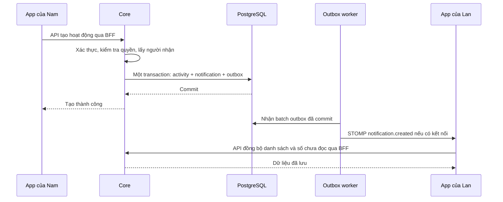

**Kế hoạch thông báo TripBudget: WebSocket + PostgreSQL + API**

Ngày khảo sát: 30/10/2026. Trạng thái: bản đầu một Core instance đã được triển khai; xem notifications-implementation.vi.md để biết hợp đồng thực tế và các phần còn lại. Phạm vi đầu tiên là thông báo liên quan đến thành viên trip và hoạt động mới trong lịch trình; chuẩn bị phần kết nối để bổ sung chat.

**1. Quyết định kiến trúc**

Chọn Spring STOMP over native WebSocket, PostgreSQL làm nguồn dữ liệu chính, REST API cho lịch sử/trạng thái đọc, và một transactional outbox nhỏ để gửi lại khi tiến trình lỗi. Frontend dùng một kết nối cho mỗi tab đã đăng nhập, chia sẻ qua provider trong authenticated layout.

Một Core instance dùng Spring simple broker. Chỉ bật Redis Pub/Sub khi triển khai nhiều Core instance; phải hoàn thành bước này trước khi tăng replica. Redis hiện có cho session không có nghĩa đã có cầu nối realtime.

STOMP là quy ước thông điệp chạy trên WebSocket: CONNECT để bắt đầu, SUBSCRIBE để đăng ký nhận, SEND để gửi đến một destination. WebSocket cung cấp kết nối hai chiều; STOMP giúp quản lý destination và subscription. Simple broker của Spring giữ subscription trong bộ nhớ và hỗ trợ heartbeat khi có scheduler. Đây chưa phải một message broker bền vững. [Spring simple broker](https://docs.spring.io/spring-framework/reference/web/websocket/stomp/handle-simple-broker.html).

| Thành phần | Trách nhiệm | Ví dụ |
|---|---|---|
| Core service | Kiểm tra quyền, xác định người nhận, tạo thông báo | Loại người vừa tạo hoạt động khỏi danh sách nhận |
| PostgreSQL | Lưu thông báo và read_at | Lan mở lại app vẫn thấy lịch sử |
| REST API | Đọc danh sách, số chưa đọc, đánh dấu đọc | GET danh sách khi vào app |
| WebSocket/STOMP | Báo cho client đang kết nối rằng dữ liệu thay đổi | Chuông cập nhật khi Nam thêm hoạt động |
| Outbox + worker | Ghi nhận việc cần phát và thử lại | Server restart sau commit vẫn tiếp tục phát |
| Redis Pub/Sub, khi nhiều instance | Chuyển sự kiện sang instance đang giữ socket | Core B phát, Core A có socket của Lan |

Chưa có push nền khi đóng app. Có thể bổ sung FCM như một kênh giao nhận sau này mà vẫn giữ PostgreSQL/API hiện tại.

**2. Hiện trạng đã kiểm tra và ảnh hưởng đến thiết kế**

- Core: Spring Boot 4.1.0, Java 21, Spring MVC, JPA, PostgreSQL, Spring Security và Redis. Chưa có dependency/module WebSocket trong phần đã khảo sát.
- Frontend: Next.js, React, MUI; BFF đọc access_token HttpOnly rồi chuyển Bearer token tới Core. BFF JSON hiện tại không tự chuyển tiếp WebSocket Upgrade.
- Core kiểm tra JWT, session Redis và chính sách đã chấp nhận. WebSocket phải kế thừa các điều kiện này.
- Core có context path mặc định /api; cần tính cả context path khi cấu hình proxy, tránh lặp /api/api.
- PlanService.createActivity và TripMemberService.inviteMember đã có transaction, phù hợp để lưu thêm notification/outbox cùng nghiệp vụ.
- Frontend dùng useQueryGet với refetch/replaceData; không giả định có TanStack Query hay tự thêm một thư viện cache mới.
- API dùng ApiResponse, PageResponse, Hashids. Tính năng mới tiếp tục dùng các quy ước này và Entity/JPA Repository.
- ddl-auto là validate; Core không có Flyway tự chạy migration. Migration phải là bước triển khai riêng, không chạy lên DB ứng dụng trong quá trình phát triển/test.

Phát hiện nghiệp vụ quan trọng: OWNER thêm người thì membership thành ACTIVE ngay; VICE tạo lời mời thì thành INVITED. acceptMember hiện cho OWNER/VICE duyệt, không phải người được mời tự chấp nhận. Tính năng thông báo không tự thay đổi quy tắc này.

**3. Phạm vi và người nhận**

| Sự kiện | Người nhận | Nội dung và đích đến |
|---|---|---|
| TRIP_MEMBER_ADDED | Người được thêm trực tiếp | “Bạn đã được thêm vào chuyến đi”; mở trip nếu còn quyền |
| TRIP_INVITATION_PENDING | Người đang được mời | “Lời mời tham gia đang chờ duyệt”; xem trạng thái tối thiểu |
| TRIP_MEMBER_APPROVAL_REQUIRED | OWNER | “Có thành viên đang chờ duyệt”; mở quản lý thành viên |
| TRIP_MEMBERSHIP_APPROVED | Người vừa được duyệt | “Bạn đã có thể tham gia chuyến đi”; mở trip |
| TRIP_ACTIVITY_CREATED | Thành viên ACTIVE, chưa bị xóa, trừ người thao tác | “Nam đã thêm hoạt động Ăn tối”; mở ngày/hoạt động tương ứng |

Việc nhận thông báo cần duyệt dành cho OWNER là đề xuất sản phẩm của bản đầu; quyền duyệt đang có của VICE vẫn giữ nguyên.

Chỉ hỗ trợ lời mời tới tài khoản đã tồn tại như hiện tại. Mời người chưa đăng ký qua email là một phạm vi khác.

Người INVITED không được dùng thông báo để đọc chi tiết trip. Thêm API trạng thái lời mời tối thiểu, chỉ dành cho chính người được mời hoặc người có quyền quản lý; không trả lịch trình, danh sách thành viên hoặc chi tiêu.

“Hoạt động mới” ở bản đầu nghĩa là hoạt động lịch trình, không phải mọi lần sửa/xóa/chi tiêu. Các luồng AI tạo hàng loạt và copy template phải được rà soát: nếu có thành viên khác cần nhận thì dùng một thông báo tổng hợp cho cả lần tạo, không phát hàng chục thông báo. Trip mới chỉ có người thực hiện thì không tạo thông báo cho chính họ.

Không dùng membership ID một mình làm khóa chống trùng vì membership có thể được kích hoạt lại khi mời lại. Mỗi thay đổi nghiệp vụ hợp lệ có một event ID riêng; retry việc phát giữ nguyên ID đó.

**4. Luồng vận hành qua ví dụ**

Nam và Lan là thành viên ACTIVE của trip Đà Lạt. Nam thêm hoạt động “Ăn tối”.



Nếu Lan offline, notification vẫn tồn tại; worker không giữ công việc vô hạn chỉ vì không có socket. Khi Lan mở app, API tải dữ liệu. Nếu transaction tạo hoạt động rollback, notification và outbox cũng rollback. Nếu worker phát xong rồi crash trước khi ghi nhận kết quả, sự kiện có thể phát lại; client dùng eventId để bỏ trùng.

Outbox là một bảng lưu “việc cần gửi” trong cùng transaction với nghiệp vụ. Nó khắc phục khoảng trống giữa commit DB và phát sự kiện. Đổi lại cần worker, retry và dọn dữ liệu. Gửi trực tiếp ở AFTER_COMMIT đơn giản hơn nhưng vẫn có thể mất lượt phát nếu tiến trình chết đúng thời điểm; do có kế hoạch chat sớm, đề xuất làm outbox nhỏ ngay. Outbox không chứng minh trình duyệt đã nhận hoặc người dùng đã đọc. [Transactional outbox](https://microservices.io/patterns/data/transactional-outbox.html).

**5. Mô hình dữ liệu đề xuất**

Một dòng notification cho mỗi người nhận, để đọc/chưa đọc độc lập và truy vấn đơn giản.

| Bảng | Các trường chính | Ràng buộc/index |
|---|---|---|
| trip_core.notifications | id, event_id, recipient_id, actor_id, type, trip_id, target_type, target_id, payload_version, payload JSONB tối thiểu, created_at, read_at | UNIQUE(event_id, recipient_id); index(recipient_id, created_at DESC, id DESC); partial index cho read_at IS NULL |
| trip_core.realtime_outbox | id, event_id, recipient_id, event_type, notification_id, status, attempts, next_attempt_at, lease_until, claim_token, created_at, dispatched_at, last_error | UNIQUE(event_id, recipient_id); index hỗ trợ lấy việc đến hạn và lease hết hạn |

Trường ID nội bộ dùng quy ước entity hiện có; ID trả client mã hóa Hashids khi tương ứng với thực thể nghiệp vụ. eventId dùng UUID. Không thêm foreign key sang public.users của Identity trong phạm vi này.

Payload notification lưu mã loại và dữ liệu hiển thị tối thiểu, không sao chép toàn bộ lịch trình/chi tiêu. Frontend dịch VI/EN theo type; không render HTML từ payload. Với thông báo hoạt động, kiểm tra quyền hiện tại trước khi trả nội dung chi tiết; danh sách và unread count dùng cùng điều kiện hiển thị. Thông báo về chính membership của người nhận có thể giữ nội dung trạng thái tối thiểu sau khi quyền trip thay đổi.

Đánh dấu đọc idempotent: gọi nhiều lần vẫn chỉ giữ một trạng thái đã đọc. Nhận qua socket, hiển thị toast và đọc là ba sự kiện khác nhau; không tự đánh dấu đọc khi socket nhận được dữ liệu.

Ưu điểm một dòng/người: truy vấn và cập nhật rõ ràng. Nhược: trip có N người nhận tạo O(N) dòng và làm transaction lớn hơn. Với nhóm du lịch nhỏ đây là lựa chọn hợp lý; broadcast quy mô lớn cần tạo recipients theo batch bất đồng bộ và định nghĩa thời điểm chốt danh sách người nhận. Chưa áp dụng thiết kế broadcast đó khi chưa có số liệu.

Worker nhận batch trong transaction ngắn, gắn lease và claim token, sau đó phát ngoài transaction; chỉ worker còn giữ claim được ghi nhận hoàn tất. Lỗi tạm thời retry theo backoff có giới hạn; lỗi quá ngưỡng chuyển FAILED, có cảnh báo và cách retry thủ công. Lease hết hạn cho phép xử lý lại sau crash. Query/locking đặt trong Repository, không SQL trực tiếp trong service.

Ở bản một instance, dùng scheduler không chạy chồng và optimistic locking để claim. Khi nhiều worker, kiểm thử tranh chấp và cân nhắc native query SKIP LOCKED trong JPA Repository nếu cần; không suy diễn rằng mọi query JPA tự có cơ chế này.

Mục tiêu worker lấy việc mỗi khoảng 0,5–1 giây, batch có giới hạn; đây là giá trị khởi đầu cần đo. Đây là polling nội bộ một worker tới DB, không phải từng người dùng liên tục gọi API. Không thêm đường gửi trực tiếp thứ hai ở bản đầu để tránh phát trùng ngoài kiểm soát.

**6. Hợp đồng API và realtime**

Các URL dưới đây là API phía trình duyệt; route BFF ánh xạ sang Core theo context path đang cấu hình.

| API | Chức năng |
|---|---|
| GET /api/notifications?page=0&size=20&unreadOnly=false | Danh sách mới nhất trước, PageResponse, giới hạn size |
| GET /api/notifications/unread-count | Số chưa đọc thuộc người đang đăng nhập |
| PATCH /api/notifications/{id}/read | Đánh dấu một thông báo đã đọc |
| PATCH /api/notifications/read-all | Đánh dấu những dòng thuộc user đang có trong snapshot của lệnh UPDATE |
| GET /api/notifications/{id}/target | Kiểm tra quyền/trạng thái hiện tại, trả đích nội bộ được allowlist hoặc TARGET_UNAVAILABLE |
| GET /api/trip-invitations/{memberId}/status | Trạng thái tối thiểu cho lời mời của chính user hoặc người quản lý |
| GET /api/realtime/bootstrap | Khởi tạo thông tin bảo vệ CONNECT theo cơ chế CSRF đã chọn |

Controller lấy @CurrentUser; client không truyền recipientId để quyết định đọc hộp thư của ai. Giữ ApiResponse, mã lỗi và Hashids hiện tại. read-all không đánh dấu những dòng commit sau snapshot của lệnh UPDATE; thay đổi read state cũng tạo outbox để tab/thiết bị khác đồng bộ.

Phân trang ban đầu dùng Pageable/PageResponse như dự án; sắp xếp created_at DESC, id DESC. Khi có thông báo mới, reset/tải lại trang đầu và bỏ trùng ID khi ghép danh sách. Phân trang offset có thể dịch trang lúc insert đồng thời; không coi page number là cursor đồng bộ đáng tin cậy. Chat sau này nên có cursor riêng cho lịch sử dài.

Đề xuất endpoint kết nối public: wss://<app-domain>/realtime, reverse proxy tới endpoint /ws trong Core (mặc định đường thực /api/ws). Client subscribe /user/queue/notifications. Spring hỗ trợ user destination và phân phối tới các session của người nhận; vẫn phải cấu hình xác thực và giới hạn subscription. [Spring user destinations](https://docs.spring.io/spring-framework/reference/web/websocket/stomp/user-destination.html).

```json
{
  "schemaVersion": 1,
  "eventId": "uuid",
  "type": "notification.created",
  "occurredAt": "2026-10-30T08:00:00Z",
  "data": { "notificationId": "encoded-id" }
}
```

Các event đầu tiên: notification.created và notification.read-state-changed. Event nhỏ đóng vai trò yêu cầu đồng bộ; API cung cấp nội dung có kiểm tra quyền. Frontend gộp các yêu cầu refetch gần nhau, không tăng badge mù bằng +1 vì có thể nhận trùng, đảo thứ tự hoặc đọc ở thiết bị khác. Event version giúp thay đổi hợp đồng sau này.

**7. Xác thực và vòng đời kết nối**

Chọn cùng origin qua reverse proxy để giữ token HttpOnly:

1. Browser gọi API qua Next.js BFF như hiện tại.
2. Browser mở /realtime; proxy chuyển Upgrade, Cookie và Origin sang Core.
3. Core bổ sung cách lấy access_token từ cookie CHỈ cho endpoint handshake /ws; những API khác giữ Bearer token. Dùng JwtDecoder, kiểm tra type=access, sid/session và policy hiện có; gắn Principal từ kết quả xác thực.
4. Allowlist Origin cụ thể; triển khai CSRF cho STOMP CONNECT qua bootstrap, chuyển đúng cookie/token cần thiết qua BFF. Không giả định csrf.disable của HTTP cũng đã giải quyết bảo vệ STOMP. Kiểm tra tính tương thích với Spring Security đang dùng trước khi chốt cấu hình.
5. Chỉ cho phép subscribe queue cá nhân đã định nghĩa. Chặn subscribe destination của người khác, wildcard và gửi giả event trực tiếp vào /queue hoặc /topic. Bản notification chưa cho client gửi lệnh nghiệp vụ qua socket.
6. Theo dõi sid và thời điểm token hết hạn trên session socket. Ngắt khi hết hạn; client refresh qua BFF rồi kết nối lại. Kiểm tra session còn hiệu lực trước outbound delivery; bổ sung kiểm tra định kỳ để thu hồi kết nối nhàn rỗi. Lỗi kiểm tra quyền/session phải fail closed.
7. Logout đóng socket và xóa state client. Logout ở thiết bị khác được phát hiện bằng kiểm tra session; không dựa hoàn toàn vào client tự đóng.

Browser WebSocket không cho tùy ý thêm Authorization header như Axios. Vì vậy không đưa access token vào localStorage hay query URL để giải quyết việc này. Auth ở HTTP handshake được Spring chuyển sang Principal của WebSocket. [Spring token authentication](https://docs.spring.io/spring-framework/reference/web/websocket/stomp/authentication-token-based.html), [Spring WebSocket security](https://docs.spring.io/spring-security/reference/servlet/integrations/websocket.html).

Giả định triển khai cần xác minh ở bước đầu: có thể cấu hình cùng-domain proxy tới Core. Nếu hosting frontend không hỗ trợ route này, phương án thay thế là endpoint realtime riêng với vé kết nối ngắn hạn, dùng một lần, cấp qua BFF; đó là thay đổi thiết kế auth cần đánh giá trước khi code, không mở cookie/token cho mọi origin.

Heartbeat phát hiện mất kết nối; reconnect dùng exponential backoff có jitter, tối đa khoảng 30 giây. 401 xử lý refresh có giới hạn; session bị thu hồi hoặc policy chưa chấp nhận không reconnect vô hạn. Giới hạn frame size, số connection/subscription và hàng đợi gửi; client quá chậm được ngắt rồi đồng bộ lại bằng API.

Proxy phải hỗ trợ Upgrade và idle timeout phù hợp heartbeat. Next.js JSON route hiện tại không thay thế cấu hình này. [Nginx WebSocket proxying](https://nginx.org/en/docs/http/websocket.html).

**8. Frontend và trải nghiệm người dùng**

- Một RealtimeProvider trong authenticated layout; một kết nối mỗi tab, không tạo socket theo từng component. Provider quản lý kết nối/subscription; feature notification xử lý dữ liệu riêng. Không đưa socket vào server component.
- Thêm chuông và badge trong AppTopBar; mở trang thông báo trên mobile, danh sách hoặc trang phù hợp desktop. Giữ các quy tắc UI/theme/i18n hiện tại.
- Tổ chức src/features/notification/{components,hooks,types,constants}; các hook feature dùng base hooks/Axios hiện tại. Phần realtime dùng chung đặt ở base, không nhét API vào component.
- Hiển thị chưa đọc, thời gian, đánh dấu đọc/tất cả, tải thêm, empty/loading/error và nút thử lại. Thông báo target đã bị xóa/thu hồi hiển thị trạng thái phù hợp, không đưa người dùng vào vòng lặp lỗi.
- Chỉ toast một lần cho event mới đang nhận trực tiếp; mở lại app tải lịch sử không bắn hàng loạt toast cũ.
- Kết nối và đăng ký xong thì tải snapshot API. Nếu có event trong lúc GET đang chạy, đặt cờ cần đồng bộ và chạy một lượt bổ sung sau khi GET hoàn tất, không bỏ qua event hoặc để response cũ ghi đè state mới.
- Khi socket chưa kết nối được vẫn tải lịch sử qua API. Khi reconnect, focus lại tab hoặc mở hộp thư thì đồng bộ lại. Nếu không nhận được tín hiệu lỗi nhưng mất event, lần đồng bộ tiếp theo sửa trạng thái; bản đầu không hứa mọi badge luôn đúng từng mili giây.
- Dedupe eventId có bộ nhớ giới hạn; gộp refetch qua coordinator để tránh mưa request. Khi đổi user/logout phải hủy request cũ và xóa toàn bộ state, tránh lộ dữ liệu tài khoản trước.

**9. Redis, mở rộng và các lựa chọn khác**

| Hướng | Ưu điểm | Nhược điểm / khi nên dùng |
|---|---|---|
| Polling + PG + API | Đơn giản, ít vận hành kết nối | Có độ trễ theo chu kỳ, tải request lặp; chưa tận dụng mục tiêu chat |
| SSE + PG + API | Phù hợp server đẩy thông báo một chiều | Chat có thể gửi qua HTTP nhưng typing/presence hai chiều kém thống nhất hơn lựa chọn WS |
| Native WS tự định nghĩa JSON | Kiểm soát giao thức, ít lớp | Tự viết routing/subscription/heartbeat; dự án Spring đã có STOMP hỗ trợ |
| STOMP WS + PG + API | Hợp Spring; queue cá nhân; dùng chung kết nối cho chat | Phải xử lý auth lâu dài, reconnect, proxy và scale |
| FCM + PG + API | Thêm được push nền trên nền tảng hỗ trợ | Phụ thuộc quyền push/nền tảng; không thay thế giao thức hội thoại hai chiều |
| STOMP relay qua RabbitMQ | Broker chuyên trách, phù hợp nhu cầu messaging lớn hơn | Thêm vận hành broker, cấu hình delivery; chưa cần cho bản đầu |

Trong môi trường nhiều Core instance: outbox worker publish một lần vào Redis; tất cả Core subscribe; mỗi Core chỉ chuyển tới các socket cục bộ của người nhận. Không vừa gửi trực tiếp vừa publish. Nếu sau này Spring chia sẻ user registry hoặc relay broker, phải xem lại routing để tránh các node cùng fan-out một event nhiều lần.

Redis Pub/Sub có delivery at-most-once: subscriber ngắt sẽ bỏ lỡ, không replay. Worker đánh dấu dispatched chỉ nói đã bàn giao cho transport, không nói user nhận được. PostgreSQL/API vẫn là cách phục hồi. Nếu yêu cầu replay/ack bền vững nâng cao, đánh giá Redis Streams hoặc RabbitMQ, kèm thiết kế fan-out tới đúng node; không đổi sang consumer group rồi mặc định mọi node đều nhận cùng message. [Redis Pub/Sub](https://redis.io/docs/latest/develop/pubsub/).

**10. Chuẩn bị chat mà không trộn dữ liệu**

Tái sử dụng auth, provider, heartbeat, reconnect, event envelope, outbound dispatcher và outbox. Chat có entity/repository/service/API riêng: conversation, message, membership/read cursor tùy mô hình room được chọn.

Luồng chat dự kiến: client gửi message với clientMessageId → Core kiểm tra quyền room → lưu message và outbox cùng transaction → trả xác nhận đã lưu kèm server message ID → phát tới thành viên → người offline tải lịch sử khi quay lại. UNIQUE(sender_id, client_message_id) chống trùng khi client retry. Receipt của STOMP không tự đồng nghĩa với message đã commit nghiệp vụ.

Chat cần thêm thứ tự xác định theo conversation và cursor đồng bộ; không dựa vào thứ tự arrival trên socket giữa nhiều worker. Typing/presence là tín hiệu tạm thời, có TTL, không lưu thành notification hoặc tạo outbox bền vững. Read receipt của chat tách khỏi read_at của notification. Kiểm tra quyền khi gửi/subscribe và thu hồi quyền đang tồn tại khi rời room/trip.

Có thể dùng cùng một WebSocket cho cả notification và chat nhưng destination và handler khác nhau. Không tạo một dòng thông báo chuông cho mọi tin nhắn ngay từ đầu; cần quy tắc unread/mute/mention riêng khi làm chat.

**11. Các bước thực hành và đầu ra**

| Bước | Công việc | Điều kiện hoàn tất |
|---|---|---|
| 0. Chốt hợp đồng theo repo | Xác minh hosting/proxy, một hay nhiều Core instance; đặc tả các event/thông báo thành viên hiện có; rà các đường tạo hoạt động | Có event matrix, API contract và sơ đồ auth triển khai được |
| 1. PostgreSQL + REST | Migration theo số chưa dùng; NotificationEntity/Repository/Service/Controller; outbox entity/repository; DTO, index, API trạng thái/target | Đọc/đánh dấu đúng user, phân trang ổn, migration được thử trên DB dùng một lần |
| 2. Tích hợp nghiệp vụ | Gọi NotificationService trong transaction invite/reactivate/approve/createActivity; chọn recipients; gộp bulk | Rollback không sinh thông báo; đúng người nhận; không trùng event |
| 3. WebSocket + worker | Dependency Spring tương thích Boot hiện tại, STOMP, auth/CSRF, queue cá nhân, claim/retry, proxy config | Hai session nhận đúng; restart phục hồi outbox; không subscribe chéo user |
| 4. Frontend | STOMP client tương thích, provider, hooks/BFF, chuông, inbox, read actions, reconnect/resync, i18n | Online cập nhật; offline mở lại đủ lịch sử; không toast/badge trùng |
| 5. Hoàn thiện vận hành | Integration/load test, metrics, retry FAILED, dọn outbox đã hoàn tất, tài liệu rollout/rollback | Đạt tiêu chí bên dưới; có kết quả đo và giới hạn rõ |
| 6. Nhiều instance, khi cần | Redis bridge, claim cạnh tranh, test socket ở A/mutation ở B | Không bỏ sót routing do khác node; không gửi trùng ngoài khả năng dedupe |

Backend dự kiến thêm notification/{entities,repositories,services,controllers,dtos,enums}, realtime cho cấu hình/auth/dispatcher, và outbox cho worker/persistence. Dùng concrete service theo repo, không tự dựng notification microservice hoặc framework provider tổng quát. Các tên/đường dẫn chi tiết chốt theo cấu trúc gần nhất khi triển khai.

Ước lượng định hướng cho một người đã quen repo: 6–10 ngày làm việc cho bước 0–5, thêm khoảng 1–2 ngày cho nhiều instance. Không phải cam kết; hosting, kiểm thử session và semantics lời mời có thể làm thay đổi thời gian. Chat là giai đoạn sau, không tính trong ước lượng này.

**12. Kiểm thử, mục tiêu vận hành và rollout**

| Tình huống | Kết quả phải đạt |
|---|---|
| OWNER thêm Lan | Lan nhận “được thêm”, không thấy nút chấp nhận lời mời không tồn tại |
| VICE mời Lan | Lan thấy chờ duyệt; OWNER thấy yêu cầu duyệt; không lộ lịch trình cho Lan |
| Mời lại membership cũ hợp lệ | Có thông báo mới; retry phát cùng event không tạo thêm dòng |
| Nam tạo activity trong trip có Nam/Lan/Minh | Lan/Minh ACTIVE nhận; Nam không nhận; INVITED/REMOVED không nhận |
| Transaction lỗi | Không còn activity mới, notification hoặc outbox của transaction đó |
| Crash sau commit, trước phát | Worker khởi động lại tiếp tục xử lý outbox |
| Crash sau phát, trước hoàn tất | Event có thể lặp nhưng UI không lặp toast/dòng hoặc tăng sai badge |
| Lan offline rồi quay lại | API có lịch sử đầy đủ dù không nhận frame cũ |
| GET đang chạy thì event đến | Có lượt đồng bộ bổ sung; response cũ không làm mất thông báo |
| Đọc ở một trong hai tab | API giữ read_at; tab còn lại cập nhật qua sự kiện/resync |
| Token hết hạn, logout từ thiết bị khác | Refresh hợp lệ mới reconnect; session bị thu hồi không tiếp tục nhận dữ liệu |
| Giả recipient/subscription/Origin | Bị từ chối, không đọc hoặc đánh dấu dữ liệu của user khác |
| Thành viên bị xóa, trip/activity bị xóa | Target kiểm tra lại quyền/trạng thái, nội dung nhạy cảm không bị trả tiếp |
| Hai instance, nếu triển khai | Mutation ở B tới socket ở A; Redis gián đoạn phục hồi bằng API, không hứa replay Pub/Sub |

Chạy unit test quyền/người nhận/idempotency, integration PostgreSQL dùng DB dùng một lần, WebSocket integration với client xác thực, frontend tests cho state/reconnect/race, TypeScript và scoped ESLint. Bỏ qua smoke test theo quy tắc repo. Không chạy migration/test phá dữ liệu lên DB ứng dụng.

Mục tiêu ban đầu để đo, chưa phải kết quả đã kiểm chứng: P95 commit→UI cập nhật dưới 2 giây trong kịch bản 100 kết nối và 5 lần tạo sự kiện/giây, nhóm 5 người; tăng tải theo số người dùng thực tế. Đo cả latency API đọc, query count, outbox lag, queue depth, retry/failure, active connections, reconnect và tài nguyên CPU/RAM. Không chỉ đo số WebSocket mở được.

Rollout: chuẩn bị migration tương thích bổ sung → áp dụng theo quy trình DB riêng → deploy backend với cờ tạo/phát notification kiểm soát được → cấu hình proxy → deploy frontend → bật dần và theo dõi. Nếu cần rollback realtime, tắt worker/transport nhưng giữ inbox qua API; không xóa notification/outbox. Retry FAILED và retention là tác vụ vận hành có giới hạn batch. Đề xuất giữ outbox dispatched 7 ngày rồi dọn; chưa tự xóa lịch sử notification khi chưa có chính sách sản phẩm.

Phạm vi hoàn tất của kế hoạch: xác định nền tảng và trình tự triển khai notification có thể tái sử dụng cho chat. Tài liệu này giữ định hướng thiết kế; mã, migration, kết quả kiểm chứng và giới hạn của bản đầu được ghi tại notifications-implementation.vi.md.
